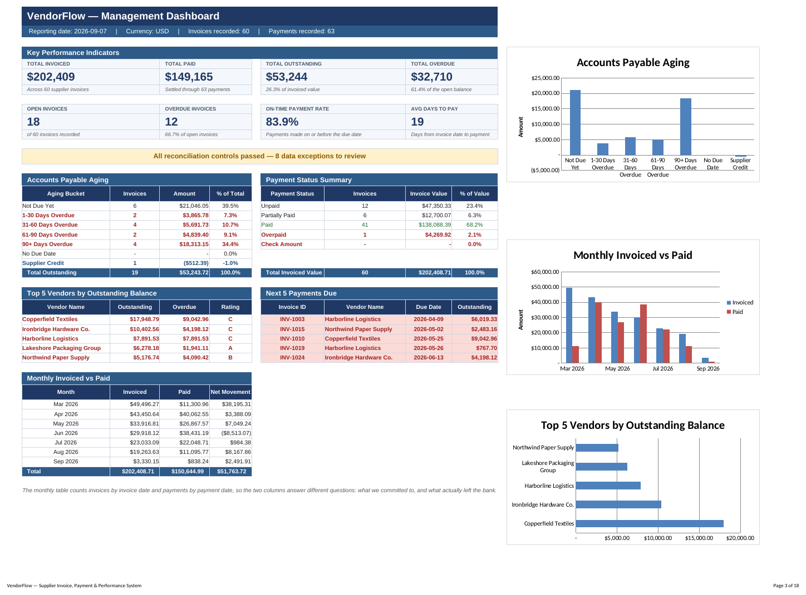
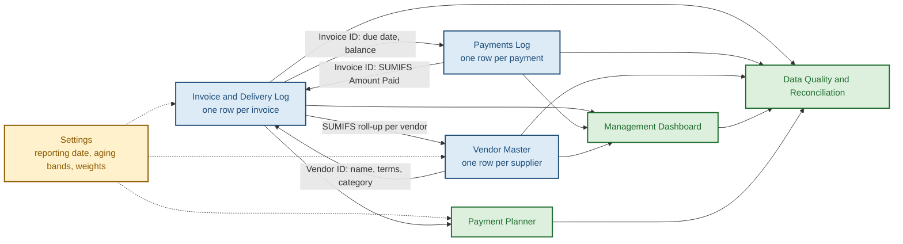
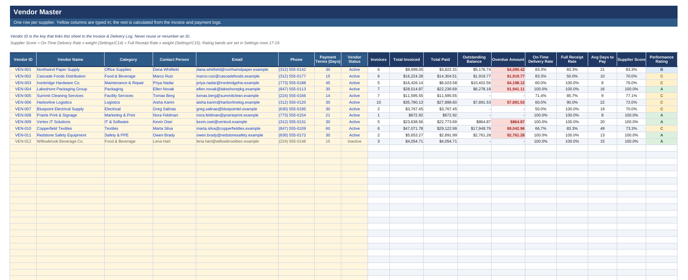
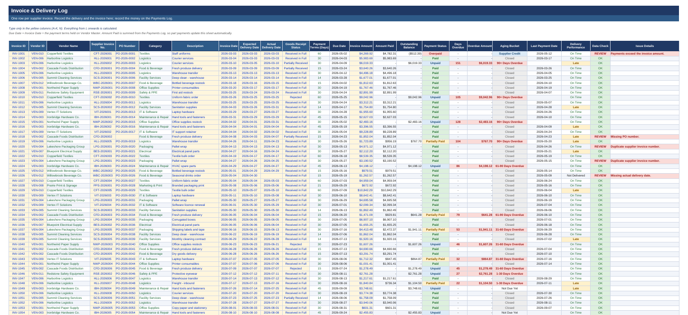
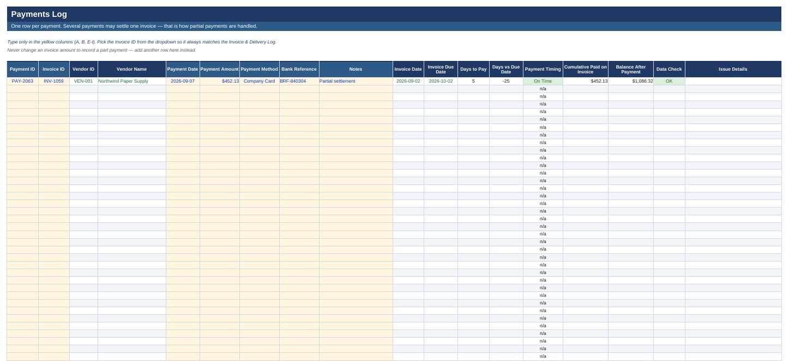
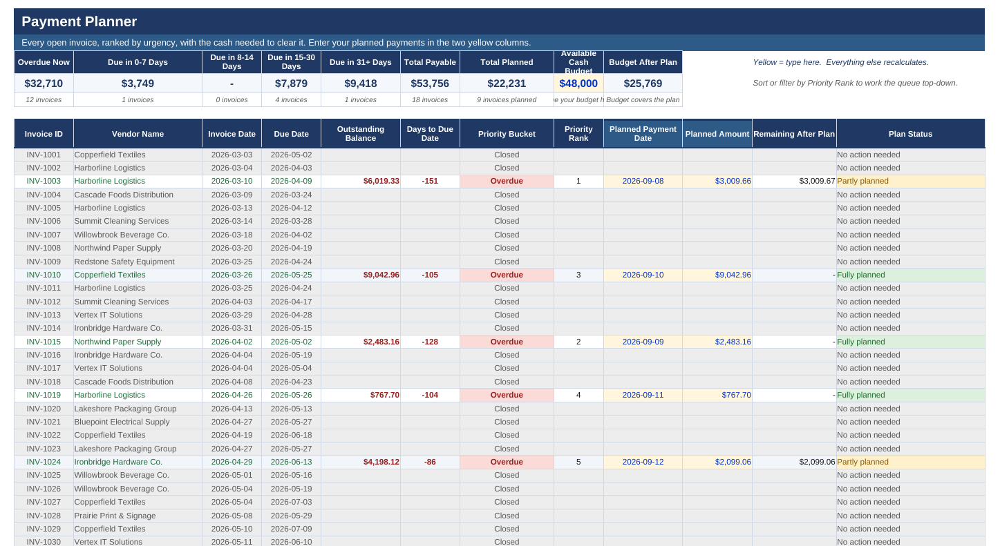
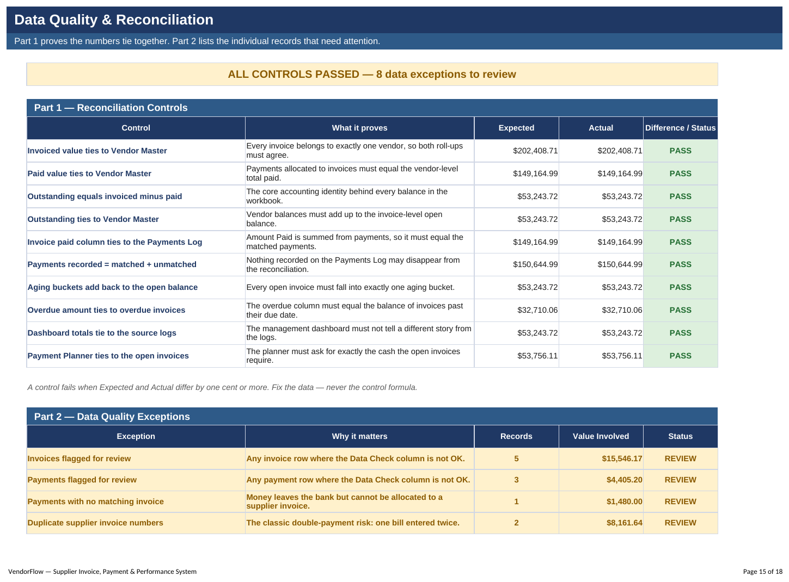
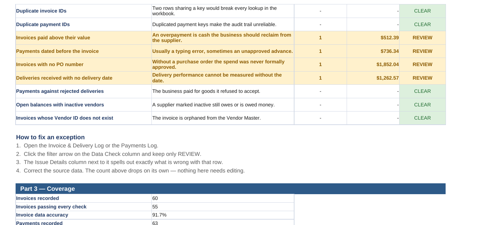

# VendorFlow — Supplier Invoice, Payment & Performance System

**A formula-driven accounts-payable control system built in Excel.** It records supplier deliveries and invoices, tracks full and partial payments, calculates outstanding and overdue balances automatically, catches data errors before they become double payments, prioritises upcoming payments against a cash budget, and reports everything on a management dashboard.




---

## The problem

A small business receives goods from a dozen suppliers on different payment terms. Invoices arrive by email and on paper. Payments go out in instalments. Within a few months nobody can answer three basic questions with confidence:

- **How much do we actually owe right now, and how much of it is already late?**
- **Did we pay this invoice twice?**
- **Which supplier keeps delivering late?**

Spreadsheets that try to answer this usually fail in the same way: someone edits an invoice amount to "show" a partial payment, the audit trail disappears, and the totals quietly stop meaning anything.

## What this system does differently

| Principle | How it is enforced |
|---|---|
| **The invoice amount is never edited** | Partial payments are separate rows in a payments log; the invoice recalculates its own balance with `SUMIFS` |
| **Every number is derived, not typed** | Employees type in 11 columns. 6,756 formulas produce everything else |
| **The file proves itself correct** | 10 reconciliation controls tie every total back to its source; they must all read `PASS` |
| **Errors are found, not discovered later** | 13 exception checks flag duplicate invoices, orphan payments, overpayments and missing approvals |
| **One date drives all time logic** | A single Reporting Date cell controls every overdue, aging and planning calculation |

---

## Repository contents

```
vendorflow-excel-ap-system/
├── VendorFlow.xlsx              ← the working system (open this)
├── README.md
├── data/                        ← sample data exported as CSV, previewable on GitHub
│   ├── vendor_master.csv
│   ├── invoice_delivery_log.csv
│   ├── payments_log.csv
│   └── payment_planner.csv
├── docs/
│   ├── USER_GUIDE.md            ← how an employee and a manager use the file
│   ├── DATA_DICTIONARY.md       ← every column, its type, and its formula
│   └── VALIDATION.md            ← the full test and reconciliation report
└── screenshots/
```

---

## How the system is connected

Three tables hold data. Four sheets only read from them, so the numbers cannot disagree.



**Two keys hold it together:** `Vendor ID` links suppliers to invoices, and `Invoice ID` links invoices to payments. Both are enforced by dropdown validation, so an employee physically cannot type an ID that does not exist.

---

## The six modules

### 1 · Vendor Master
One row per supplier: contacts, payment terms, status. Everything from column I onward is calculated — invoice count, total invoiced, total paid, outstanding, overdue, on-time delivery rate, full-receipt rate, average days to pay, and a weighted supplier score converted into an **A–D performance rating**.



### 2 · Invoice & Delivery Log
The core table. Records both the delivery (expected vs actual date, goods receipt status) and the invoice (amount, supplier reference, PO number). Calculates due date, amount paid, outstanding balance, payment status, days overdue, aging bucket, delivery performance, and a per-row data check.



### 3 · Payments Log
One row per payment — **several rows may settle one invoice**, which is how partial payments are handled without ever touching the invoice amount. Each row shows cumulative paid on that invoice, the balance remaining after it, and whether the payment was on time.



### 4 · Payment Planner
Every open invoice with a **priority rank** computed by formula — no manual sorting. A summary strip totals cash needed by urgency band (overdue / 0–7 / 8–14 / 15–30 / 31+ days) and checks it against an available cash budget.



### 5 · Data Quality & Reconciliation
Part 1 proves the workbook balances. Part 2 lists the individual records that need attention.




### 6 · Management Dashboard
Eight KPIs, an AP aging table, payment status summary, top 5 vendors by exposure, next 5 payments due, a monthly invoiced-vs-paid trend, and three charts. It stores nothing of its own.

---

## How the main calculations work

| Field | Logic |
|---|---|
| **Due Date** | `Invoice Date + payment terms`, where terms are pulled from Vendor Master by `INDEX/MATCH` |
| **Amount Paid** | `SUMIFS` over every payment row carrying this `Invoice ID` |
| **Outstanding Balance** | `ROUND(Invoice Amount − Amount Paid, 2)` |
| **Payment Status** | `Unpaid` → `Partially Paid` → `Paid`; more than the invoice value → `Overpaid` |
| **Days Overdue** | `MAX(0, Reporting Date − Due Date − grace days)`, only when a balance remains |
| **Aging Bucket** | Not Due Yet / 1–30 / 31–60 / 61–90 / 90+ days, with band limits read from Settings |
| **Priority Rank** | `COUNTIFS` counts how many open invoices have an earlier due date → ranks 1, 2, 3… with the Invoice ID as tie-breaker |
| **Delivery Performance** | `Actual Delivery Date ≤ Expected Delivery Date` → On Time / Late |
| **Supplier Score** | `0.6 × on-time delivery rate + 0.4 × full-receipt rate` → A / B / C / D |
| **Issue Details** | Eleven conditions concatenated with `&`, so one cell explains in words exactly what is wrong with that row |

**Every monetary comparison is wrapped in `ROUND(…, 2)`.** Without it, floating-point residue of a hundredth of a cent leaves a fully paid invoice sitting in the "open" list forever.

---

## Data integrity

### 10 reconciliation controls — all passing

Each control compares an **expected** value against an **actual** value computed by a different route. A difference of one cent or more raises `FAIL`.

| # | Control | Proves |
|---|---|---|
| 1 | Invoiced value ties to Vendor Master | Every invoice belongs to exactly one vendor |
| 2 | Paid value ties to Vendor Master | Vendor-level and invoice-level payments agree |
| 3 | Outstanding = invoiced − paid | The core accounting identity |
| 4 | Outstanding ties to Vendor Master | Vendor balances add up to the invoice ledger |
| 5 | Invoice paid column ties to Payments Log | Nothing is allocated twice |
| 6 | Payments recorded = matched + unmatched | No recorded payment disappears from the reconciliation |
| 7 | Aging buckets add back to the open balance | Every invoice falls in exactly one bucket |
| 8 | Overdue amount ties to overdue invoices | The overdue column is internally consistent |
| 9 | Dashboard totals tie to the source logs | Management reporting cannot drift from the ledger |
| 10 | Payment Planner ties to the open invoices | The plan requests exactly the cash required |

### 13 exception checks

Duplicate supplier invoice numbers · duplicate invoice IDs · duplicate payment IDs · payments with no matching invoice · overpaid invoices · payments dated before their invoice · future-dated records · missing PO numbers · missing delivery dates · payments on rejected deliveries · open balances with inactive vendors · invoices with an unknown Vendor ID · invoices with a non-positive amount.

---

## Testing

The sample data was generated independently in Python, and the workbook's output was then checked **cell by cell** against that independent calculation.

| Test | Result |
|---|---|
| Formula evaluation (LibreOffice recalculation) | 6,756 formulas, **0 errors** |
| Row-level verification of 60 invoices, 63 payments, 12 vendors | **0 discrepancies** across due dates, balances, statuses, overdue days, aging, ratings and cumulative sums |
| 10 reconciliation controls | **10 PASS** |
| Priority ranking | Contiguous 1…n, ordered by due date, no ties |
| Function compatibility audit | No `XLOOKUP`, `FILTER`, `UNIQUE`, `SORT`, `TEXTJOIN` — Google Sheets safe |
| **Stress test**: added a new vendor, 2 invoices and 2 partial payments into the blank prepared rows, then moved the Reporting Date forward one month | All 10 controls still **PASS**; ranks recalculated 1…20; overdue count correctly rose from 12 to 19 |

Full report: [`docs/VALIDATION.md`](docs/VALIDATION.md)

---

## A bug the reconciliation caught

The first full run failed control #9. The dashboard reported an open balance of **$53,756.11** while the invoice ledger reported **$53,243.72** — a gap of exactly **$512.39**.

That gap was the overpaid invoice. An overpayment makes the invoice balance *negative*, and I had grouped every non-positive balance into a single `Closed` bucket. The dashboard's aging table summed the open buckets and legitimately excluded it; the ledger summed everything and legitimately included it. Both were right, which is why the difference was invisible until a control compared them.

**The fix was conceptual, not cosmetic:** a negative balance is not a closed invoice, it is a *supplier credit* — money the business is owed back. It became its own aging category, visible on the dashboard as a negative line. Control #9 then tied to the cent, and the distinction between "what we owe" and "our net ledger position" became explicit rather than accidental.

> A control that never fires has never been tested. This one justified its existence on the first run.

---

## Design decisions

**Planned payments are stored on the invoice row, not the planner.** A self-sorting planner would re-order its rows whenever a new invoice was added, silently reattaching a typed plan amount to the wrong invoice. Inputs stay anchored to a stable row; the ranking is a calculated column.

**Internal `Invoice ID` is separate from `Supplier Invoice No.`** The internal key never breaks lookups, while duplicate *supplier* references are still detected — which is the actual double-payment risk.

**Only Excel 2007-era functions.** `XLOOKUP` and `FILTER` are more elegant but break on import into Google Sheets. Everything here is `INDEX/MATCH`, `SUMIFS`, `COUNTIFS` and `SUMPRODUCT`.

**Six errors are planted in the sample data on purpose** so the Data Quality sheet demonstrably catches something. They are listed on the workbook's README tab; delete those rows and every exception clears while the controls stay at `PASS`.

---

## Using it

1. Open `VendorFlow.xlsx` and read the **README** tab.
2. **Type only in yellow cells.** Blue text on a light yellow background means input; everything else is a formula.
3. Add suppliers → **Vendor Master**. Add invoices → **Invoice & Delivery Log**. Add payments → **Payments Log**.
4. Record a partial payment as a **new row**, never by editing the invoice amount.
5. Check **Data Quality & Reconciliation** daily — every control must read `PASS`.
6. Set `Settings!C5` (Reporting Date), or replace it with `=TODAY()` to make the workbook follow the calendar.

Formula rows are prepared to row 157 (invoices) and 207 (payments). To extend, select the last formula row and drag down.

Detailed instructions: [`docs/USER_GUIDE.md`](docs/USER_GUIDE.md)

---

## Technical constraints

- **No VBA, no macros, no Power Query, no add-ins** — the file is portable and opens anywhere
- Microsoft Excel 2007+, LibreOffice Calc, and Google Sheets (core features survive import)
- 8 sheets · 6,756 formulas · 47 conditional-formatting rules · 13 data-validation rules
- Sample data: 12 vendors, 60 invoices, 63 payments — entirely fictional

---

## Author

**Zainabkhon Saidova** — B.S. Information and Decision Sciences, University of Illinois Chicago (expected May 2028)
Google Data Analytics Professional Certificate

Licensed under the [MIT License](LICENSE).
